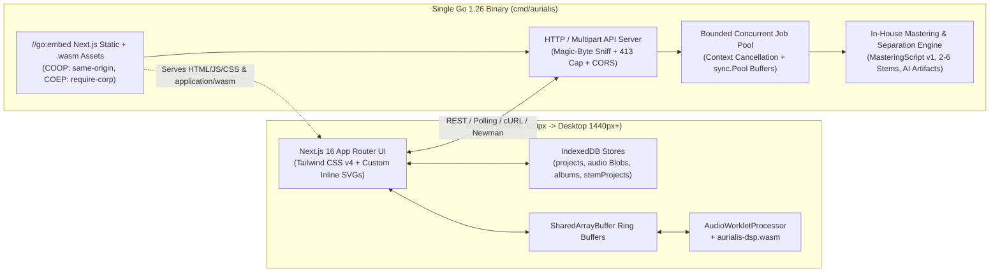

# Aurialis-WASM Technical Architecture

Maintained by [`aurialis-tech-writer`](../.claude/agents/aurialis-tech-writer.md) in collaboration with [`aurialis-backend`](../.claude/agents/aurialis-backend.md), [`aurialis-frontend`](../.claude/agents/aurialis-frontend.md), [`aurialis-designer`](../.claude/agents/aurialis-designer.md), and [`aurialis-security`](../.claude/agents/aurialis-security.md).

---

## 1. High-Level System Topology

---

## 2. Single-Binary Go + Next.js 16 Embedding (`cmd/aurialis`)

- **Frontend Build**: Next.js 16 (`^16.4.2`) compiles with `pnpm run build` on Node `26.12.0` into static/standalone assets.
- **WASM Compilation**: `GOOS=js GOARCH=wasm go build -trimpath -o public/wasm/aurialis-dsp.wasm ./wasm/dsp` compiles our Go DSP package into a compact WebAssembly binary before the Go host binary embeds the static bundle.
- **Cross-Origin Isolation Middleware**: Every response serving the application shell, scripts, and worklets attaches:
  - `Cross-Origin-Opener-Policy: same-origin`
  - `Cross-Origin-Embedder-Policy: require-corp`
  - `Content-Type: application/wasm` on `.wasm` routes.

---

## 3. Concurrent Job Orchestration (`internal/jobs`)

When multiple users or batch operations trigger simultaneous jobs (Smart Split `2–6` stems, Deep Analysis `MasteringScript` v1, Album Batch Mastering):
- **Bounded Worker Pool**: A fixed-size worker pool bounded by CPU/memory semaphores prevents unbounded goroutine spawning or OOM spikes.
- **Context Cancellation**: Every job owns a `context.WithCancel` stored in the job registry; `DELETE /jobs/{id}` or client disconnect cancels the context and stops DSP/analysis loops immediately.
- **Zero-Copy Buffer Pooling**: `sync.Pool` recycles Float32 sample buffers and FFT scratch slices so 10-minute audio files (`TS-012`) do not trigger GC thrashing.

---

## 4. Frontend Component Reuse & Mobile-First Architecture (`src/`)

- **Zero External Icon Libraries**: All icons are rendered through `src/components/shared/Icon.tsx` using inline SVG paths. Waveforms, 5-band parametric EQ curves, Deep automation timelines, album consistency charts, and reference overlays are bespoke responsive SVGs paired with accessible text summaries and labeled form inputs.
- **Shared Primitive Hierarchy**:
  - `src/components/layout/{AppShell,Navigation,PageHeader}.tsx`
  - `src/components/shared/{Button,Icon,DropZone,Modal,BottomSheet,EmptyState,StatusBadge}.tsx`
  - `src/components/controls/{SliderField,SegmentedControl,Toggle,ProcessingState}.tsx`
  - `src/components/audio/{Transport,Waveform,MetricStrip,SpectrumChart,DeepTimeline,DeepMoveEditor,EngineerProfilePicker}.tsx`
- **Mobile-First Responsive Breakpoints**:
  - `320px–767px` (Base): Compact top bar, 4-item bottom nav, sticky mini-transport, accordion DSP panels, horizontally scrollable Deep timeline with sticky lane headers, bottom-sheet move editor, `>=44×44px` touch targets.
  - `768px–1023px` (`md:`): 2-column analysis cards and side-by-side module layouts.
  - `1024px–1440px+` (`lg:`/`xl:`): Fixed `230px` left rail, central visualization canvas, `360px` right inspector, and sticky bottom transport.

---

## 5. Host-Machine Protection & Audio Content Disarm & Reconstruction (`aurialis-security`)

Because users run `aurialis` directly on their host workstation and load audio files from external sources, the architecture enforces defense-in-depth so a malicious upload can never hide or execute a payload on the host machine:

1. **Zero Persistent Raw Uploads & Ephemeral `0600` Sandboxing**:
   - User-uploaded container bytes are never saved to the host filesystem under user-supplied filenames or extensions.
   - Audio decoding operates in bounded memory (`sync.Pool` Float32 PCM buffers). If a large batch job requires temporary disk spill, it writes only to an isolated `0700` temp directory (`os.MkdirTemp`) using random CSPRNG UUID `.pcm.tmp` filenames opened with `O_CREATE|O_EXCL|O_RDWR|O_NOFOLLOW` and `0600` (non-executable) permissions, and unlinks them immediately on job completion, cancellation, or server startup/shutdown.
2. **Audio Content Disarm & Reconstruction (CDR)**:
   - The Go audio parser verifies magic bytes and container structure, rejects polyglots (`MZ`, `\x7fELF`, Mach-O, `PK\x03\x04` ZIP/JAR trailers, `%PDF`, HTML/script tags), strips all non-audio chunks (`LIST`, `INFO`, `ID3`, `JUNK`, `PAD`, and trailing bytes after the declared `data` chunk), and decodes only finite `float32` PCM samples.
   - Any exported or cached audio is synthesized freshly from pure PCM samples — destroying any appended polyglot archive or hidden metadata payload.
3. **Localhost & Browser Hardening**:
   - Binds to `127.0.0.1` by default; validates `Host` and `Origin`/`Sec-Fetch-Site` headers to block DNS rebinding and drive-by localhost CSRF from malicious websites.
   - Bans `os/exec` (`exec.Command`) in all request and audio processing paths; runs DSP inside Go and memory-isolated WebAssembly (`GOOS=js GOARCH=wasm` / `GOOS=wasip1 GOARCH=wasm`).
   - Serves strict `Content-Security-Policy`, `Cross-Origin-Opener-Policy: same-origin`, `Cross-Origin-Embedder-Policy: require-corp`, `Cross-Origin-Resource-Policy: same-origin`, `X-Content-Type-Options: nosniff`, and `X-Frame-Options: DENY`.
