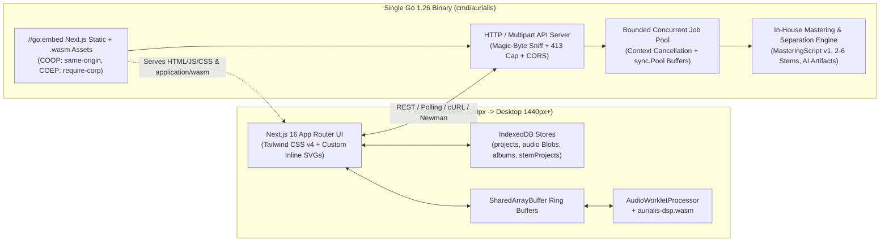

# Aurialis-WASM Technical Architecture

Maintained by [`aurialis-tech-writer`](../.claude/agents/aurialis-tech-writer.md) in collaboration with [`aurialis-backend`](../.claude/agents/aurialis-backend.md), [`aurialis-dsp-plugin-engineer`](../.claude/agents/aurialis-dsp-plugin-engineer.md), [`aurialis-audio-engineer`](../.claude/agents/aurialis-audio-engineer.md), [`aurialis-grammy-veteran`](../.claude/agents/aurialis-grammy-veteran.md), [`aurialis-frontend`](../.claude/agents/aurialis-frontend.md), [`aurialis-designer`](../.claude/agents/aurialis-designer.md), and [`aurialis-security`](../.claude/agents/aurialis-security.md).

---

## 1. High-Level System Topology

---

## 2. Single-Binary Go + Next.js 16 Embedding (`cmd/aurialis`)

- **Frontend Build**: Next.js 16 (`^16.4.2`) compiles with `pnpm run build` on Node `26.12.0` into static/standalone assets.
- **WASM Compilation**: `GOOS=js GOARCH=wasm go build -trimpath -o public/wasm/aurialis-dsp.wasm ./wasm/dsp` compiles our Go DSP package into a compact WebAssembly binary before the Go host binary embeds the static bundle.
- **Cross-Origin Isolation Middleware**: Every response serving the application shell, scripts, and worklets attaches:
  - `Cross-Origin-Opener-Policy: same-origin`
  - `Cross-Origin-Embedder-Policy: require-corp`
  - `Content-Type: application/wasm` on `.wasm` routes.

---

## 3. Concurrent Job Orchestration (`internal/jobs`)

When multiple users or batch operations trigger simultaneous jobs (Smart Split `2–6` stems, Deep Analysis `MasteringScript` v1, Album Batch Mastering):
- **Bounded Worker Pool**: A fixed-size worker pool bounded by CPU/memory semaphores prevents unbounded goroutine spawning or OOM spikes.
- **Context Cancellation**: Every job owns a `context.WithCancel` stored in the job registry; `DELETE /jobs/{id}` or client disconnect cancels the context and stops DSP/analysis loops immediately.
- **Zero-Copy Buffer Pooling**: `sync.Pool` recycles Float32 sample buffers and FFT scratch slices so 10-minute audio files (`TS-012`) do not trigger GC thrashing.

---

## 4. Frontend Component Reuse & Mobile-First Architecture (`src/`)

- **Zero External Icon Libraries**: All icons are rendered through `src/components/shared/Icon.tsx` using inline SVG paths. Waveforms, 5-band parametric EQ curves, Deep automation timelines, album consistency charts, and reference overlays are bespoke responsive SVGs paired with accessible text summaries and labeled form inputs.
- **Shared Primitive Hierarchy**:
  - `src/components/layout/{AppShell,Navigation,PageHeader}.tsx`
  - `src/components/shared/{Button,Icon,DropZone,Modal,BottomSheet,EmptyState,StatusBadge}.tsx`
  - `src/components/controls/{SliderField,SegmentedControl,Toggle,ProcessingState}.tsx`
  - `src/components/audio/{Transport,Waveform,MetricStrip,SpectrumChart,DeepTimeline,DeepMoveEditor,EngineerProfilePicker}.tsx`
- **Mobile-First Responsive Breakpoints**:
  - `320px–767px` (Base): Compact top bar, 4-item bottom nav, sticky mini-transport, accordion DSP panels, horizontally scrollable Deep timeline with sticky lane headers, bottom-sheet move editor, `>=44×44px` touch targets.
  - `768px–1023px` (`md:`): 2-column analysis cards and side-by-side module layouts.
  - `1024px–1440px+` (`lg:`/`xl:`): Fixed `230px` left rail, central visualization canvas, `360px` right inspector, and sticky bottom transport.

---

## 5. Host-Machine Protection & Audio Content Disarm & Reconstruction (`aurialis-security`)

Because users run `aurialis` directly on their host workstation and load audio files from external sources, the architecture enforces defense-in-depth so a malicious upload can never hide or execute a payload on the host machine:

1. **Zero Persistent Raw Uploads & Ephemeral `0600` Sandboxing**:
   - User-uploaded container bytes are never saved to the host filesystem under user-supplied filenames or extensions.
   - Audio decoding operates in bounded memory (`sync.Pool` Float32 PCM buffers). If a large batch job requires temporary disk spill, it writes only to an isolated `0700` temp directory (`os.MkdirTemp`) using random CSPRNG UUID `.pcm.tmp` filenames opened with `O_CREATE|O_EXCL|O_RDWR|O_NOFOLLOW` and `0600` (non-executable) permissions, and unlinks them immediately on job completion, cancellation, or server startup/shutdown.
2. **Audio Content Disarm & Reconstruction (CDR)**:
   - The Go audio parser verifies magic bytes and container structure, rejects polyglots (`MZ`, `\x7fELF`, Mach-O, `PK\x03\x04` ZIP/JAR trailers, `%PDF`, HTML/script tags), strips all non-audio chunks (`LIST`, `INFO`, `ID3`, `JUNK`, `PAD`, and trailing bytes after the declared `data` chunk), and decodes only finite `float32` PCM samples.
   - Any exported or cached audio is synthesized freshly from pure PCM samples — destroying any appended polyglot archive or hidden metadata payload.
3. **Localhost & Browser Hardening**:
   - Binds to `127.0.0.1` by default; validates `Host` and `Origin`/`Sec-Fetch-Site` headers to block DNS rebinding and drive-by localhost CSRF from malicious websites.
   - Bans `os/exec` (`exec.Command`) in all request and audio processing paths; runs DSP inside Go and memory-isolated WebAssembly (`GOOS=js GOARCH=wasm` / `GOOS=wasip1 GOARCH=wasm`).
   - Serves strict `Content-Security-Policy`, `Cross-Origin-Opener-Policy: same-origin`, `Cross-Origin-Embedder-Policy: require-corp`, `Cross-Origin-Resource-Policy: same-origin`, `X-Content-Type-Options: nosniff`, and `X-Frame-Options: DENY`.

---

## 6. Analog-Modeled DSP Engine, Beating the Waves Workflow & Audio Verification (`aurialis-audio-engineer`, `aurialis-dsp-plugin-engineer`, `aurialis-grammy-veteran`, `aurialis-qa`)

1. **Digitizing Vintage & Modern Audio Hardware (`wasm/dsp` & `internal/audio`)**:
   - **5-Band Parametric Mastering EQ**: Topology-Preserving Transform (`TPT` / Zero-Delay Feedback SVF) filters with proportional-$Q$ behavior and zero high-frequency Nyquist cramping (`12–20 kHz` air shelves remain open and silky at `44.1`/`48 kHz`).
   - **Program-Dependent Bus Compression**: Optical (LA-2A two-stage release), Variable-Mu (soft-knee level-dependent ratio), FET (`1176` fast transient clamping), and VCA (`SSL`/`API` bus glue) ballistics with a `90 Hz` sidechain high-pass ("Thrust") filter so sub-bass never pumps the vocal/midrange.
   - **Anti-Aliased Analog Saturation (`Warm` / `Thick` / `Crisp`)**: First-order Antiderivative Anti-Aliasing (`ADAA`) + 2× polyphase oversampling modeling asymmetric triode even harmonics ($H_2$ `Warm`), Ampex-style tape odd harmonics + head bump ($H_3$ `Thick`), and frequency-dependent iron transformer bass weight (`Crisp`).
   - **Phase-Coherent Mid/Side & Linkwitz-Riley Mono-Bass**: 4th-order (`24 dB/oct`) Linkwitz-Riley crossover locking sub-bass (`<110 Hz`) in mono while widening highs cleanly without comb filtering.
   - **4× Oversampled True-Peak Brickwall Limiter & TPDF Dither**: ITU-R BS.1770-4 4-phase FIR inter-sample peak (`dBTP`) lookahead limiting + Triangular Probability Density Function (`TPDF`) dither on 16/24-bit WAV exports.
2. **How Aurialis Beats a Traditional Waves Plugin-Chain Workflow**:
   - **Loudness-Matched A/B Comparison**: Eliminates Fletcher-Munson volume deception (where `L2` or `CLA-76` sounds "better" simply because it is `+5 dB` louder) by providing instant loudness-compensated A/B listening alongside raw output comparison.
   - **Section-Aware Dynamic Automation (`MasteringScript` v1)**: Replaces manual automation across 6 floating DAW plugin windows with unified, inspectable section envelopes (`Intro`, `Verse`, `Chorus`, `Bridge`, `Drop`, `Breakdown`, `Outro`) across `Volume`, `EQ`, `Comp/Sat`, `Width`, and `AI Repair`.
   - **Integrated `2–6` Smart Stem Separation & Album Cohesion**: Fixes mix-balance issues (`Vocals`, `Drums`, `Bass`, `Guitar`, `Piano`, `Other`) and album-wide LUFS/tonal outliers inside the same zero-bloat single binary.
3. **War-Room Audio Transformation Verification Suite**:
   - Automated tests (`internal/audio/verify_test.go`, `wasm/dsp/dsp_verify_test.go`, Newman `TS-015`, and Playwright E2E export verification) feed deterministic laboratory test signals (multi-tone sines, step bursts, out-of-phase stereo signals) and verify via FFT/Goertzel magnitude deltas, compressor dB envelopes, $H_2/H_3$ harmonic ratios, stereo phase correlation, and section LUFS/width deltas that every DSP module and profile modifies the audio in the exact physically expected way.
