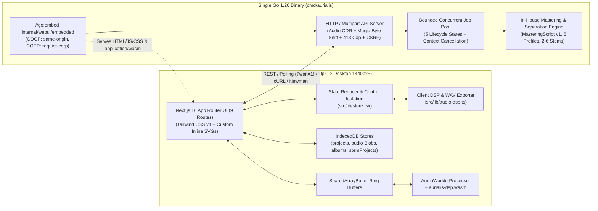

# Aurialis-WASM Technical Architecture
<!-- cspell:words Embedder goroutines trimpath RDWR inspectable -->

Maintained by [`aurialis-tech-writer`](../.claude/agents/aurialis-tech-writer.md) in collaboration with [`aurialis-backend`](../.claude/agents/aurialis-backend.md), [`aurialis-dsp-plugin-engineer`](../.claude/agents/aurialis-dsp-plugin-engineer.md), [`aurialis-audio-engineer`](../.claude/agents/aurialis-audio-engineer.md), [`aurialis-grammy-veteran`](../.claude/agents/aurialis-grammy-veteran.md), [`aurialis-frontend`](../.claude/agents/aurialis-frontend.md), [`aurialis-designer`](../.claude/agents/aurialis-designer.md), and [`aurialis-security`](../.claude/agents/aurialis-security.md).

---

## 1. High-Level System Topology

---

## 2. Single-Binary Go + Next.js 16 Embedding (`cmd/aurialis`)

- **Host Entrypoint (`cmd/aurialis/main.go`)**:
  - Compiles to a single standalone native binary `aurialis`.
  - **CLI Flags**:
    - `-addr`: HTTP listen address (default `127.0.0.1:8080`, bound to loopback by default). Also honors `AURIALIS_ADDR` and `PORT` environment variables.
    - `-workers`: Number of concurrent audio DSP worker goroutines (default `0` = auto-detected from CPU count).
    - `-max-upload-bytes`: Maximum upload payload size in bytes (default `209715200` = 200 MB). Also honors `MAX_UPLOAD_BYTES_OVERRIDE`.
- **Frontend Embedding (`internal/webui`)**:
  - Next.js 16 (`^16.4.2`) produces a static export via `pnpm run build` into `out/`.
  - `scripts/sync-webui.mjs` copies `out/` into `internal/webui/embedded/`.
  - The Go package `internal/webui` embeds the assets via `//go:embed all:embedded`. During local development, `cmd/aurialis` automatically falls back to serving directly from `out/` if present.
- **WASM Embedding**:
  - `GOOS=js GOARCH=wasm go build -trimpath -o public/wasm/aurialis-dsp.wasm ./wasm/dsp` compiles the pure-Go DSP package into WebAssembly.
  - The server serves `/wasm/aurialis-dsp.wasm` with `Content-Type: application/wasm` from `public/wasm/` or embedded assets.
- **Cross-Origin Isolation Middleware**: Every response serving the application shell, scripts, and worklets attaches:
  - `Cross-Origin-Opener-Policy: same-origin`
  - `Cross-Origin-Embedder-Policy: require-corp`
  - `Cross-Origin-Resource-Policy: same-origin`
  - `X-Content-Type-Options: nosniff`
  - `X-Frame-Options: DENY`
  - `Referrer-Policy: no-referrer`
  - Strict `Content-Security-Policy`.

---

## 3. Concurrent Job Orchestration (`internal/jobs`)

When multiple users or batch operations trigger simultaneous jobs (Smart Split `2–6` stems, Deep Analysis `MasteringScript` v1, Album Batch Mastering):
- **Bounded Worker Pool**: A fixed-size worker pool bounded by CPU/memory semaphores prevents unbounded goroutine spawning or OOM spikes. If the queue is saturated, requests return `503 Service Unavailable` (`queue_full`).
- **Job Lifecycle States**:
  - `queued`: Waiting for an available worker in the pool.
  - `running`: Actively executing DSP or acoustic analysis.
  - `done`: Finished successfully; output stems or `MasteringScript` ready.
  - `cancelled`: Canceled by user request (`DELETE /jobs/{id}`).
  - `failed`: Terminated with an error.
- **Server Long-Polling**: `GET /jobs/{id}?wait=1` holds the HTTP connection for up to 4 seconds while the job is `queued` or `running`, returning immediately once the job resolves to `done`, `cancelled`, or `failed`.
- **Context Cancellation**: Every job owns a `context.WithCancel` stored in the thread-safe job registry; `DELETE /jobs/{id}` or client disconnect cancels the context and stops DSP/analysis loops immediately.
- **Zero-Copy Buffer Pooling**: `sync.Pool` recycles Float32 sample buffers and FFT scratch slices so 10-minute audio files (`TS-012`) do not trigger GC thrashing.

---

## 4. Frontend Component Hierarchy, Store Isolation & Routes (`src/`)

### 9 Next.js 16 App Router Routes
1. `/` (`src/app/page.tsx`): Home dropzone and rapid onboarding.
2. `/library` (`src/app/library/page.tsx`): IndexedDB-backed track and project management table.
3. `/albums` (`src/app/albums/page.tsx`): Multi-track album project listing.
4. `/albums/[albumId]` (`src/app/albums/[albumId]/page.tsx`): Album track sequencing, consistency visualization, and batch mastering.
5. `/master/[trackId]` (`src/app/master/[trackId]/page.tsx`): Interactive mastering workstation (Transport, SVG Waveform, Simple mode, Advanced 5-band EQ, compressor, saturation, limiter, M/S stereo width, Deep timeline).
6. `/split/[trackId]` (`src/app/split/[trackId]/page.tsx`): Smart Split stem separation with 2–6 stem selector, stem mutes/solos, and handoff to mastering.
7. `/reference/[trackId]` (`src/app/reference/[trackId]/page.tsx`): Reference track tonal curve comparison and overlay.
8. `/release-check/[trackId]` (`src/app/release-check/[trackId]/page.tsx`): Platform delivery compliance audit across Spotify, Apple Music, YouTube, SoundCloud, CD, and Podcast.
9. `/tools` (`src/app/tools/page.tsx`): Standalone utility audio tools.

### State Reducer & Control Isolation (`src/lib/store.tsx`)
- Centralized React context and reducer managing project state, track audio, album sequencing, and DSP parameters.
- **Control Isolation**: Strict per-module action dispatches (`SET_INPUT_GAIN`, `SET_EQ_BAND`, `SET_COMPRESSOR_*`, `SET_SATURATION_*`, `SET_STEREO_*`, `SET_LIMITER_*`, `SET_REPAIR_*`) ensure adjustments to one DSP module never mutate or cross-couple into adjacent modules (verified by `src/lib/__tests__/control-isolation.test.ts` and Playwright `control-isolation.spec.ts`).

### Client-Side DSP Engine & WAV Exporter (`src/lib/audio-dsp.ts`)
- Interactive preview processing and client-side rendering pipeline:
  - 5-band biquad parametric EQ (`highpass`, `lowshelf`, `peaking`, `peaking`, `highshelf`/`peaking`).
  - Optical/VCA compressor with sidechain filtering and makeup gain.
  - Analog saturation modeling (`Warm` $H_2$, `Thick` $H_3$, and `Crisp` low-end warmth).
  - Mid/Side stereo widening with 1-pole mono-bass crossover.
  - Brickwall ceiling limiter.
  - TPDF-dithered 16-bit, 24-bit, and 32-bit Float WAV audio exporter.

### Zero External Icon Libraries
- Hand-crafted inline SVGs only (`src/components/shared/Icon.tsx`). External libraries (`lucide-react`, `@heroicons/react`, `react-icons`) are strictly banned by ESLint rules and CI checks.

---

## 5. Host-Machine Protection & Audio Content Disarm & Reconstruction (`aurialis-security`)

Because users run `aurialis` directly on their host workstation and load audio files from external sources, the architecture enforces defense-in-depth so a malicious upload can never hide or execute a payload on the host machine:

1. **Zero Persistent Raw Uploads & Ephemeral `0600` Sandboxing**:
   - User-uploaded container bytes are never saved to the host filesystem under user-supplied filenames or extensions.
   - Audio decoding operates in bounded memory (`sync.Pool` Float32 PCM buffers). If a large batch job requires temporary disk spill, it writes only to an isolated `0700` temp directory (`os.MkdirTemp`) using random CSPRNG UUID `.pcm.tmp` filenames opened with `O_CREATE|O_EXCL|O_RDWR|O_NOFOLLOW` and `0600` (non-executable) permissions, and unlinks them immediately on job completion, cancellation, or server startup/shutdown.
2. **Audio Content Disarm & Reconstruction (CDR)**:
   - The Go audio parser (`internal/audio/cdr.go`) verifies magic bytes and container structure, rejects polyglots (`MZ`, `\x7fELF`, Mach-O, `PK\x03\x04` ZIP/JAR trailers, `%PDF`, HTML/script tags), strips all non-audio chunks (`LIST`, `INFO`, `ID3`, `JUNK`, `PAD`, and trailing bytes after the declared `data` chunk), and decodes only finite `float32` PCM samples.
   - Any exported or cached audio is synthesized freshly from pure PCM samples — destroying any appended polyglot archive or hidden metadata payload.
3. **Localhost & Browser Hardening**:
   - Binds to `127.0.0.1` by default; validates `Host` and `Origin`/`Sec-Fetch-Site` headers to block DNS rebinding and drive-by localhost CSRF from malicious websites.
   - Bans `os/exec` (`exec.Command`) in all request and audio processing paths; runs DSP inside Go and memory-isolated WebAssembly (`GOOS=js GOARCH=wasm` / `GOOS=wasip1 GOARCH=wasm`).
   - Serves strict `Content-Security-Policy`, `Cross-Origin-Opener-Policy: same-origin`, `Cross-Origin-Embedder-Policy: require-corp`, `Cross-Origin-Resource-Policy: same-origin`, `X-Content-Type-Options: nosniff`, and `X-Frame-Options: DENY`.

---

## 6. Analog-Modeled DSP Engine, Beating the Waves Workflow & Audio Verification (`aurialis-audio-engineer`, `aurialis-dsp-plugin-engineer`, `aurialis-grammy-veteran`, `aurialis-qa`)

1. **Digitizing Vintage & Modern Audio Hardware (`wasm/dsp` & `internal/audio/dsp`)**:
   - **5-Band Parametric Mastering EQ**: Topology-Preserving Transform (`TPT` / Zero-Delay Feedback SVF) filters with proportional-$Q$ behavior and zero high-frequency Nyquist cramping (`12–20 kHz` air shelves remain open and silky at `44.1`/`48 kHz`).
   - **Program-Dependent Bus Compression**: Optical (LA-2A two-stage release), Variable-Mu (soft-knee level-dependent ratio), FET (`1176` fast transient clamping), and VCA (`SSL`/`API` bus glue) ballistics with a `90 Hz` sidechain high-pass ("Thrust") filter so sub-bass never pumps the vocal/midrange.
   - **Anti-Aliased Analog Saturation (`Warm` / `Thick` / `Crisp`)**: First-order Antiderivative Anti-Aliasing (`ADAA`) + 2× polyphase oversampling modeling asymmetric triode even harmonics ($H_2$ `Warm`), Ampex-style tape odd harmonics + head bump ($H_3$ `Thick`), and frequency-dependent iron transformer bass weight (`Crisp`).
   - **Phase-Coherent Mid/Side & Linkwitz-Riley Mono-Bass**: 4th-order (`24 dB/oct`) Linkwitz-Riley crossover locking sub-bass (`<110 Hz`) in mono while widening highs cleanly without comb filtering.
   - **4× Oversampled True-Peak Brickwall Limiter & TPDF Dither**: ITU-R BS.1770-4 4-phase FIR inter-sample peak (`dBTP`) lookahead limiting + Triangular Probability Density Function (`TPDF`) dither on 16/24-bit WAV exports.
2. **How Aurialis Beats a Traditional Waves Plugin-Chain Workflow**:
   - **Loudness-Matched A/B Comparison**: Eliminates Fletcher-Munson volume deception (where `L2` or `CLA-76` sounds "better" simply because it is `+5 dB` louder) by providing instant loudness-compensated A/B listening alongside raw output comparison.
   - **Section-Aware Dynamic Automation (`MasteringScript` v1)**: Replaces manual automation across 6 floating DAW plugin windows with unified, inspectable section envelopes (`Intro`, `Verse`, `Chorus`, `Bridge`, `Drop`, `Breakdown`, `Outro`) across `Volume`, `EQ`, `Comp/Sat`, `Width`, and `AI Repair`.
   - **Integrated `2–6` Smart Stem Separation & Album Cohesion**: Fixes mix-balance issues (`Vocals`, `Drums`, `Bass`, `Guitar`, `Piano`, `Other`) and album-wide LUFS/tonal outliers inside the same zero-bloat single binary.
3. **War-Room Audio Transformation Verification Suite**:
   - Automated tests (`internal/audio/verify_test.go`, `wasm/dsp/dsp_verify_test.go`, Newman `TS-015`, and Playwright E2E export verification) feed deterministic laboratory test signals (multi-tone sines, step bursts, out-of-phase stereo signals) and verify via FFT/Goertzel magnitude deltas, compressor dB envelopes, $H_2/H_3$ harmonic ratios, stereo phase correlation, and section LUFS/width deltas that every DSP module and profile modifies the audio in the exact physically expected way.

---

## 7. Honest Architectural Caveats & Known Discrepancies

1. **Client TypeScript DSP vs. Go/WASM Reference Engine**:
   The browser UI includes a per-sample TypeScript DSP chain (`src/lib/audio-dsp.ts`) featuring a 1-pole mono-bass crossover and sample-peak limiter for low-latency interactive slider response. The Go/WASM engine (`internal/audio/dsp`, `wasm/dsp`) is the calibrated reference implementation with ZDF/TPT SVF filters, 4th-order Linkwitz-Riley crossover, and 4× oversampled True-Peak limiting.
2. **AudioWorklet Live Playback Routing**:
   The frontend UI currently routes interactive preview audio through `HTMLAudioElement` and client TypeScript DSP. Direct real-time browser playback routing through the compiled WASM `AudioWorklet` processor (`public/worklets/aurialis-dsp-worklet.js`) is scheduled for a subsequent integration slice.
3. **Simple-Mode Metrics Parameter Estimation**:
   Metrics shown in Simple mode are parameter-estimated approximations derived from DSP configuration rather than measured directly from decoded PCM waveforms.
4. **Vulnerability Scan Gate (`govulncheck`)**:
   `govulncheck ./...` reports Go standard library finding `GO-2026-6617` on Go `1.26.2`. This is an upstream Go standard library vulnerability remediated in Go `1.26.9`.

